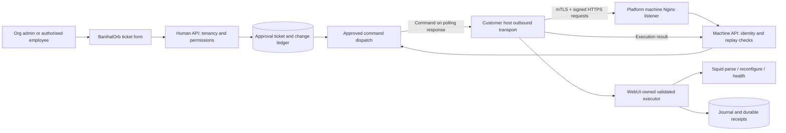
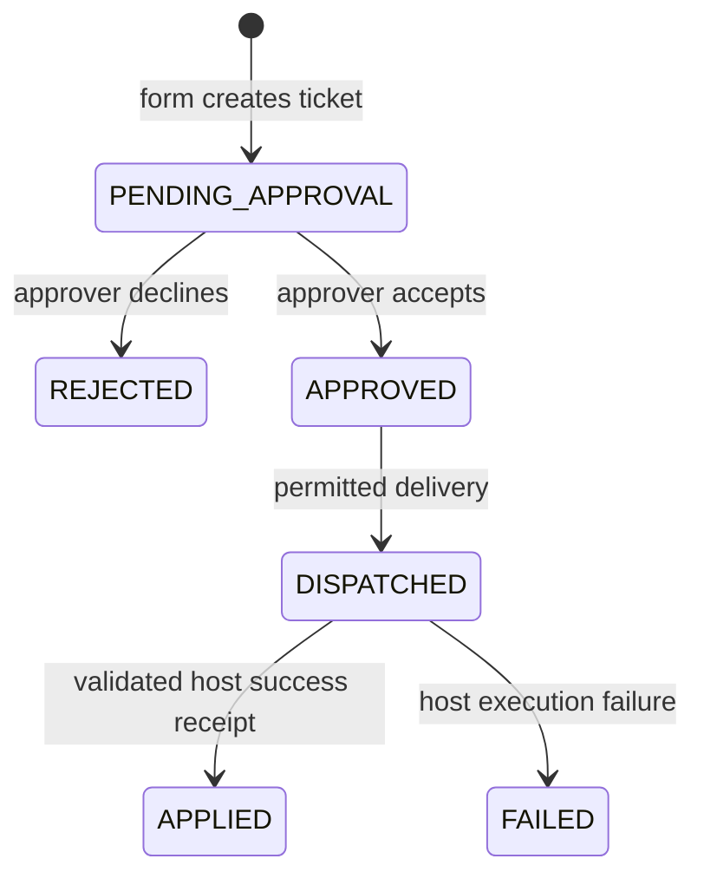

# BanihalOrb ↔ Squid WebUI integration architecture

Status: implementation contract and remaining host work, 6 November 2026. Product: `2.0.0-dev.0`, unreleased. Read with [production rollout](squid-outbound-production.md). This document describes the retained ticket-only product scope; older full-proxy-management inventories are historical.

## Ownership and network model

BanihalOrb owns client/proxy connection registration, machine identities, ticket submission, approval, dispatch receipts and safety pauses. Squid WebUI owns local Squid execution and recovery. BanihalOrb users cannot browse host configuration, ACLs, ports, traffic logs or monitoring dashboards, or directly edit policy, restart Squid, restore backups or reset it.

Use ordinary HTTPS over TCP 443, initiated by each customer host. Do not add a custom TCP framing protocol, public inbound agent port or platform-to-WebUI callback. WebUI's existing local API may continue for separately authorised local administration, but BanihalOrb does not call it over the network.



No connectivity means no new automation: retain the running policy. A pause stops new dispatch; it does not terminate client traffic. Existing subscription expiry/network-disable behavior is separate and may create a deny-all policy; review that behavior explicitly before rollout.

## Human-facing API retained in BanihalOrb

Authentication uses the existing human session and role/tenant controls, not machine credentials.

| API | Responsibility |
| --- | --- |
| `GET /api/squid` | List own connection records/status; no policy content. |
| `GET /api/saas-admin/squid` and `/clients` | Authorised staff select a client and connection. |
| `POST /api/saas-admin/squid/provision` | Register a connection and return its secret once. |
| `POST .../:proxyId/rotate-key` | Replace machine registration secret. |
| `POST /api/saas-admin/squid/:proxyId/machine-identity` | Enroll/disable agent certificate fingerprint. |
| `POST /api/saas-admin/squid/:proxyId/workers/:botId/machine-identity` | Separately enroll a linked worker certificate. |
| `POST .../:proxyId/change-requests` | Validate a structured request and create its approval ticket. |
| `GET .../:proxyId/change-requests` | Show request/ticket outcome history, not current policy. |
| `GET/POST .../:proxyId/automation` | Read/set connection-level automation pause. |
| Platform client/global automation routes | Control wider safety pauses with explicit permissions. |

Organisation prefix is `/api/squid`; staff prefix is `/api/saas-admin/squid`. Endpoint sets differ: provisioning and enrollment are platform-only. Keep the existing enable/disable/delete connection lifecycle restrictions, organisation token verification and external ticket-key association. Disable may affect policy lifecycle; it is not the safe pause button.

Human configuration detail, host-config, branch/port/full-access CRUD, monitoring/report/scan and maintenance routes are removed. `/api/orb` and `/api/squid-web` are retired (410). Do not restore these as shortcuts around approval.

Example form payload:

```json
{
  "requestKey": "6a6b6e47-3012-46d5-8426-0aac984c3810",
  "action": "allow",
  "ip": "192.168.1.10",
  "domain": "example.org",
  "hours": 2,
  "reason": "Access required for supplier support"
}
```

Actions currently supported: `allow`, `deny`, `extend`, `full-net`, `lock-net`. Retain the same request UUID on network retries; reject changed payloads using the same key. Resolve client ownership from the proxy server-side. Ticket human assignment and execution proxy identity are separate. Host-side validation must also enforce valid sources, destinations, allowed durations and operation semantics; browser checks are insufficient.

## Important compatibility distinction: two existing delivery lanes

**The current form creates BOT_* changes.** Approval sends those through the SQUID_BOT command ledger and worker `/state` response. Installing only `agent.py`, which reads `/api/proxy-agent/poll`, does not execute these form requests. Do not claim otherwise.

1. **Ticket command lane — required for the current form.** Implement/integrate the SQUID_BOT worker dialect in the WebUI-owned outbound service, using the existing validated local operations as the execution callback. This may run without presenting a Slack UI; retain the existing linked worker identity expected by the platform until a separately versioned protocol migration removes that coupling.
2. **Signed bundle lane — existing compatibility support.** `agent.py` polls complete generated configuration bundles. The WebUI writer validates and applies them. Human direct bundle-policy editing is removed. Preserve this lane only for existing platform-owned policy state and migration compatibility.

Never allow independent writers in these lanes. Share the same local lock and ownership boundary. Do not route the same request into both lanes. Unifying them is future protocol work, not implemented by this documentation.

## Machine API and outbound worker

The platform terminates TLS at a dedicated Nginx machine hostname; the customer WebUI does not expose a new inbound listener. Backend access is loopback/private network only. Nginx validates the client CA/CRL and overwrites forwarded/certificate headers. The backend trusts those headers only from its explicitly configured immediate Nginx peer.

| Platform endpoint | Caller / purpose |
| --- | --- |
| `POST /api/bot-worker/:botId/state` | Linked SQUID_BOT worker reports bounded state and receives the next approved command. |
| `POST /api/bot-worker/:botId/command-result` | Worker returns a durable command outcome. |
| `POST /api/bot-worker/:botId/request` | Existing worker-origin ticket creation; not required for a WebUI adapter that only executes BanihalOrb form requests. |
| `GET /api/proxy-agent/poll` | Bundle agent heartbeat and next signed bundle. |
| `POST /api/proxy-agent/result` | Bundle agent reports revision outcome. |
| `GET /api/proxy-agent/public-key` | Public bootstrap material; verify/pin through a trusted installation channel. |

Verify the exact worker prefix against `server/src/app.ts` before configuring hosts. Worker request/response field contracts are defined in `botWorker.schema.ts`, `botWorker.routes.ts` and `squidBot.service.ts`; reuse those contracts rather than inventing a parallel payload. Existing telemetry/ticketing-config endpoints remain compatibility surfaces, not permission to expose host configuration in BanihalOrb. For this minimal adapter, avoid uploading full configs/access logs or requesting ticket API credentials when they are unnecessary.

### Authentication v2

Every machine has a distinct protected secret and client certificate. Enroll the SHA-256 certificate fingerprint. Production requires v2 and an enabled enrolled identity. Each HTTPS call carries a new nonce and signature:

```text
B2B-MACHINE-V2
proxy:<proxyId> OR worker:<botId>
<epoch milliseconds>
<32–64 lowercase hex nonce>
<UPPERCASE HTTP METHOD>
<original URL path including query>
<lowercase SHA-256 of exact body bytes>
```

The second line is one concrete actor value, not the literal `OR` expression. Join with LF and no trailing newline. HMAC-SHA256 using the machine secret becomes the hexadecimal bearer value. Headers: `X-Machine-Version: 2`, `X-Machine-Nonce`, `X-Proxy-Timestamp`/`X-Worker-Timestamp`; agents additionally identify themselves using `X-Proxy-Id`. Workers are identified by their URL bot ID. Use `machine_client.py` to preserve byte-for-byte canonicalization.

Backend validation: trusted mTLS certificate → enabled actor/secret → timestamp/signature → Redis atomic nonce reservation → ownership/mode/pause checks → operation. Timestamp tolerance is five minutes; nonce reservation is 600001ms. Replay-store outage rejects work with retryable 503. No certificate validation bypass or v1 downgrade in production. Keep keys server-side, never in WebUI JavaScript or browser storage.

## What to build/integrate inside Squid WebUI

| Module | Implementation responsibility / existing starting point |
| --- | --- |
| Connection settings backend | Protected platform origin, proxy/worker identities, CA/certificate/key paths, pinned bundle public key and state directory. UI may show masked identity/status; never return private secrets. Validate HTTPS origin and permissions. A dedicated connection-settings UI is still to build. |
| Outbound service | Use `deploy/squid/machine_client.py`; poll with bounded jitter/backoff. Extend/integrate the worker lane for current form commands. `agent.py` currently implements the bundle lane only. |
| Validated operation dispatcher | Explicitly map allowed command types to WebUI operations. Reject unknown fields/actions and arbitrary shell/file operations. Existing installed worker code is not included here; callback integration is still required. |
| Durable command execution | Wrap the validated callback using `worker_executor.execute_command(command, config, callback)`. Persist receipt before side effects, deduplicate command IDs and refuse uncertain crash outcomes until operator reconciliation. Callback must implement parse, reload, health, rollback and temporary-access expiry semantics. |
| Bundle execution | Reuse `platform_writer.py`: Ed25519 signature, target binding, revision/digest checks, managed-path allowlist, file/size bounds, atomic writes and recovery journal. |
| Single writer | Share the same state directory and flock between WebUI, worker and bundle writer. Disable competing local generation/scheduler writes in managed mode using `managed_mode.py` and `webui-managed.patch`. Authentication and read-only WebUI use remain. |
| Local status | Show transport connected/unavailable, pending/applied/failed receipt, local pause and last successful contact. Keep detailed host diagnostics local and sanitize platform errors. Connection status alone is not evidence that a ticket executed. |
| Service installation | Adapt `squid-agent.service` to the real WebUI service account. Limit privilege to required Squid commands/files; no root transport or broad sudo. The current unit starts only the bundle agent, so worker service wiring remains to build. |

Protected files: config/private key mode 0600; state directory 0700. Keep journals and command SQLite receipts durable across service upgrades. Back up these together with configuration. Do not delete receipts to force replay.

Bundle allowlist is `/etc/squid/acls/webgui_generated.conf` plus named branch whitelist/blacklist files under that directory. The writer requires the generated include, rejects duplicate paths/symlinks, limits 200 files and 1MB signed canonical content, and preserves uid/gid/mode. Trust-bootstrap signing keys out of band; downloading a new public key over an untrusted channel defeats pinning.

## Execution state and failure rules



Pauses/capacity limits hold approved work rather than treating approval as success. A lost response causes transport retry with a new nonce and the same business/command identity. Duplicate completed commands return their stored outcome. An uncertain interrupted operation requires local reconciliation; never guess success. Bundle acknowledgements are revision-bound and monotonic. Keep normal Squid service running during platform outages and bounded polling during local overload.

The host must acknowledge only after local validation, apply, reconfigure and health verification. Failures restore prior configuration; failed/uncertain rollback latches a local pause. Preserve both platform and host audit records without leaking secrets or full sensitive policy into ticket comments.

## Release acceptance checklist

- Apply the additive guardrail migration through reviewed deployment; no reset/seed.
- Install trusted server CA, distinct client certificates and pinned signing key; enroll each identity.
- Verify no weaker machine ingress; wrong cert/key, tampered method/path/body and duplicate nonce all reject.
- Run one real form ticket through approval → worker state delivery → local apply → durable result → APPLIED. Repeat for every action and temporary-access expiry.
- Verify decline, cross-client attempts, missing permissions, duplicate submit/delivery, Redis failure, offline platform, worker crash and interrupted apply recovery.
- Verify global/client/proxy/local pauses, one-at-a-time execution, queue/rate bounds and overload recovery under representative traffic.
- Import/reconcile existing local policy before enabling single-writer managed mode; prove other schedulers cannot overwrite it.
- Confirm removed human configuration/maintenance endpoints remain inaccessible and no dashboard leaks host config.
- Test existing subscription/disable behavior separately from safe automation pauses.
- Record exact application SHA, version, host adapter version and rollback reference. Unit checks alone are not end-to-end or production certification.

Remaining work is primarily the WebUI connection settings and ticket-command worker integration, real host/expiry/recovery checks and controlled rollout. The repository already provides transport, bundle writer, worker receipt adapter, managed-mode patch, tests and Nginx/service examples; these are source building blocks, not an installed host product.
