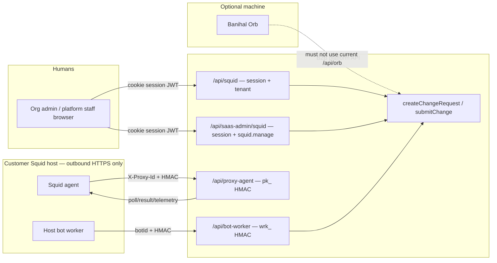

# Squid Proxy ↔ Web Application API Communications & Key Security

> Date: 2026-10-31 · Status: **Plan**
> Extends [ADR-002](../docs/decisions/ADR-002-remote-slack-bot-workers.md), [ADR-003](../docs/decisions/ADR-003-squid-host-api-consolidation.md)
> Does **not** replace ADR-003; it finishes the remaining security work and closes the incomplete Orb / `squid-web` surfaces.

**Goal:** One communication map, one change-request core, and one machine-auth pattern for every actor that talks to Squid. Humans use sessions. Machines use HMAC-bound keys. No static Bearer key is enough to mutate proxy config.

---

## 1. Constraint (frozen)

Customer hosts open **no inbound ports**. The platform never pushes. Every host process **calls home over HTTPS 443**. Commands ride **responses** to those calls (`poll`, `state`/`heartbeat`). Secrets never logged. Wire HMAC for deployed agents/workers is frozen:

```
canonical = `${ts}\n${METHOD}\n${path}\n${sha256(rawBody)}`
Authorization: Bearer <hmac-hex>
ts = epoch milliseconds, |now − ts| ≤ 300_000
path = req.originalUrl (query string included)
body = exact raw bytes (app.ts verify() buffer)
```

Shared verifier: `server/src/lib/machineAuth.ts`.

---

## 2. Actors and doors

Four actors. Three **canonical** doors. Two **must not ship** as written.



| Actor | Identity | Auth | Mount | Purpose |
|---|---|---|---|---|
| Org admin / staff | User session | Cookie JWT + role (`ORG_ADMIN` / `ADMINISTRATOR`) + `squid.view`/`squid.manage` | After cookie wall | Read dashboards, mutate via change requests / ACL APIs |
| Squid agent | `SquidProxy.id` | `pk_` HMAC, `X-Proxy-Id`, `X-Proxy-Timestamp` | **Before** cookie wall `/api/proxy-agent` | Poll signed bundle, ack result, telemetry, ticketing-config |
| Host bot | `SlackBot.id` | `wrk_` HMAC, `X-Worker-Timestamp` | **Before** cookie wall `/api/bot-worker` | Slack dialect **or** SQUID_BOT request/state/command-result |
| Banihal Orb (future) | Org-scoped `ort_` row | Same HMAC factory as other machines | **Before** cookie wall | Submit a change request; **no new `btp_` key** |

**Single write core.** Every config mutation that needs approval or an agent apply funnels through `createChangeRequest` (`squid.service.ts`) / `submitChange` (`squidBot.service.ts`). Direct Prisma writes in a third router are a drift hazard.

---

## 3. Communication flows (canonical)

### 3.1 Provision (human → host)

1. Platform admin `POST /api/saas-admin/squid/provision` → mints `pk_…`, returns **raw once**, stores `regKeyHash` + `regKeyEncrypted` + `registrationHint`.
2. Org admin confirms with `POST /api/squid/:id/verify-token` (timing-safe compare of pasted token vs decrypted copy).
3. Host file `/etc/squid-agent/env` mode `0600` holds the raw key. Never in git, never in the SPA.

Bot worker key is a **separate** mint: `POST /api/slack-bots/:id/worker-key` → `wrk_…` shown once → `workerKeyHash` + `workerKeyEnc`.

### 3.2 Agent control plane (host → platform → host)

| Call | Auth | Request | Response |
|---|---|---|---|
| `GET /api/proxy-agent/public-key` | none (Ed25519 public) | — | pin for bundle verify |
| `GET /api/proxy-agent/poll` | agent HMAC | empty body | signed config bundle + pending commands keyed by `revision` |
| `POST /api/proxy-agent/result` | agent HMAC | apply ack | `{ appliedSeq }` |
| `POST /api/proxy-agent/telemetry` | agent HMAC | counters + log lines | ingest id |
| `GET /api/proxy-agent/ticketing-config` | agent HMAC | — | linked `ExternalApiKey` clientId + **decrypted secret** |

The last route is the highest-value secret on this surface: it hands the ticketing client secret to whoever holds `pk_`. Keep it HMAC-bound; never expose it on a session route or Orb route.

Web UI does **not** call `/api/proxy-agent`. It reads `GET /api/squid/:id/status|telemetry|host-config|change-requests` and writes `POST /api/squid/:id/change-requests` plus ACL/lifecycle routes. Those bump `revision`; the agent learns on the next **poll**.

### 3.3 Host bot (SQUID_BOT dialect)

| Call | Role |
|---|---|
| `POST /api/bot-worker/:botId/request` | Slack-originated allow/deny → ticket + `SquidChangeRequest` |
| `POST /api/bot-worker/:botId/state` | lease + rules mirror; **command inbox in the response** |
| `POST /api/bot-worker/:botId/command-result` | ACK/FAIL apply |
| `GET /api/bot-worker/:botId/status` | **session admin only** (debug snapshot, not a machine door) |

SLACK_THIN keeps `provision` / `heartbeat` / `message`. Dialect gates return `409 BOT_MODE_*`.

### 3.4 Web application (browser → `/api/squid`)

Session cookie. Tenant Prisma extension scopes org data. Platform staff use `/api/saas-admin/squid` (no tenant filter, `squid.view`/`squid.manage`).

Change request from the UI:

```
Browser POST /api/squid/:proxyId/change-requests
  → authMiddleware + tenant + ORG_ADMIN + squid.manage
  → createChangeRequest → ticket + CR row
  → SSE /change-requests/stream for status
  → on approval: bump revision OR enqueue SquidBotCommand
  → agent poll / bot /state picks it up
  → result / command-result closes the CR
```

The SPA never stores `pk_` or `wrk_`. The only key the UI may show is the **hint** (`registrationHint`, `workerKeyHint`) plus a one-time raw value on mint/rotate.

### 3.5 What must not be a door

| Surface | Why it is unsafe today | Decision |
|---|---|---|
| `/api/squid-web/*` | Behind cookie wall **but** no role/tenant checks; whitelist handler double-calls `createChangeRequest` then writes a second CR; mutates ports/lists/revision directly; `actorId` falls back to `'web-admin'`. Zero SPA callers (client squid pages deleted). | **Delete** (ADR-003 Task 5). Slack notify stays in `slackWebhook.ts` called from the real controller. |
| `/api/orb/*` as shipped | Mounted **after** cookie wall so a real Orb cannot call it. Keys checked for **format only** — never loaded from DB, never hashed, never HMAC. Org is forged as `'org-' + proxyPrefix`. Invents a `btp_` key that **does not exist** in Prisma. Unused `orbKeyValidator`. `Math.random` key gen. Non-constant-time compare. Creates a ticket with a fake `customerId`, skips `SquidChangeRequest`. | **Quarantine**: unmount until redesigned. Do not document as live. |

PHASE1-IMPLEMENTATION-SUMMARY.md claims scrypt, per-key rate limits, org isolation, and execution paths that **are not in the code**. Treat that file as incorrect until rewritten after a real implementation.

---

## 4. API key model (secured access)

### 4.1 Key kinds — keep them uncoupled

| Prefix | Holder | Stored as | Presented as | Capability if stolen |
|---|---|---|---|---|
| `pk_` | Squid agent on host | `regKeyHash` (SHA-256) + `regKeyEncrypted` (AES-256-GCM) | HMAC of each request, **not** the raw key as Bearer | Poll/apply **this** proxy; fetch **this** proxy's ticketing secret |
| `wrk_` | Host bot | `workerKeyHash` + `workerKeyEnc` | HMAC of each request | That bot's provision/heartbeat/request/state |
| `adk_` | AD ingest (unrelated) | `SlackBot.apiKeyHash` | Bearer hash lookup | AD secrets ingest only |
| `ext_ck_` | External ticketing client | `secretHash` + `secretEnc` | OAuth client credentials → JWT | Ticketing scopes only |
| `ort_` | Banihal Orb (if productized) | New table: hash + enc + `customerId` + `enabled` + `expiresAt` | HMAC via `createMachineKeyAuth` | Submit change requests for **that org only** |

**Do not add `btp_`.** A second static proxy password duplicates `pk_`, is weaker (replayable Bearer), and the current validators never look it up. If Orb must prove “this org’s proxy”, bind the Orb row to `customerId` (and optional `proxyId`) in the database after HMAC succeeds.

### 4.2 Presentation rules

1. **Humans never send machine keys.** Browser → cookie. Mint/rotate responses return `{ raw, hint }` once over TLS; UI copy-once, then forget.
2. **Machines never send the raw key as a reusable Bearer for authorization.** The Bearer value is the **HMAC hex**, keyed by the raw secret. Captured traffic cannot be replayed outside the 5-minute window or against a different body/path.
3. **Hash cross-check.** Decrypt `*Enc`, SHA-256, `timingSafeEqual` against `*Hash`. Diverged columns → 401 (`KEY_DIVERGED` internally, generic `PROXY_AUTH_FAILED` / `WORKER_AUTH_FAILED` on the wire). Agent path still has this **withheld** (ADR-003 Task 4) — enable it.
4. **Five-strike disable.** Shared `badAuthCounter` (Redis if `REDIS_URL`, else memory). Agent → `status=DISABLED` + `locked`. Bot → `enabled=false`.
5. **Constant-time only.** `timingSafeEqual` after length check. No `===` / case-fold fallbacks (`verifyOrbSecret` today is unsafe).
6. **CSPRNG only.** `crypto.randomBytes` / `randomInt`. Drop `Math.floor(Math.random() * alphabet.length)` in `orbCrypto.ts`.
7. **Hints in APIs and logs; prefixes in audit metadata; never raw, never HMAC, never ciphertext.**
8. **Host files `0600`.** Rotate = mint new, restart agent/bot, old key 401s immediately (no dual-key grace unless a later ADR says otherwise).
9. **Cookie wall placement.** Machine routers **before** `authMiddleware`. Session routers after. Mixing them is how `/api/orb` became unreachable to machines and `/api/squid-web` became an unauthenticated-looking mutation API for anyone with any session cookie.

### 4.3 Orb redesign (only if the product still needs it)

Minimum viable secure Orb:

1. Table `OrbClient { id, customerId, proxyId?, keyHash, keyEnc, keyHint, enabled, expiresAt }`.
2. Mount `app.use('/api/orb', orbRoutes)` **next to** `/api/proxy-agent` (before cookies).
3. `createMachineKeyAuth` with `X-Orb-Timestamp`, `X-Orb-Id`, HMAC over the same canonical string.
4. Handler calls `submitChange` / `createChangeRequest` with `source: 'ORB'`, requester resolved from the **Orb’s org**, not from client-supplied `requesterId` (treat body IDs as untrusted).
5. Assignee = that org’s SQUID_BOT, looked up server-side.
6. Idempotency: ADR-003 Task 10 content hash, or `Idempotency-Key` header mapped to the same SET NX window.
7. Rate limit per `actorId` (reuse machineAuth counter or a dedicated bucket).
8. Webhook back to Orb (optional, later): HMAC with a **separate** webhook secret, not the request key.

Until that exists, **do not mount** the current `orb.routes.ts`.

---

## 5. Remaining security work (ordered)

Aligns with unfinished ADR-003 plus the gaps found in this review.

1. **Enable `regKeyHash` on agent `loadActor`** (ADR-003 Task 4). Test: diverged hash 401s a valid HMAC.
2. **Delete `/api/squid-web`** and its `app.ts` mount (Task 5). Keep `slackWebhook.ts`.
3. **Unmount `/api/orb`** (or 410 the router) until §4.3 is implemented. Stop treating PHASE1 summary as done.
4. **Idempotent `/request` door** (Task 10) — identical `(botId, type, payload)` within 300s returns the original receipt.
5. **Contract doc** `docs/squid-host-api.md` (Task 7) + fix `docs/Squid-bot-Web.md` §9 + vendored `INTEGRATION.md`.
6. **Opt-in nginx mTLS** comments for `/api/proxy-agent` and `/api/bot-worker` (HMAC still mandatory).
7. **Harden `GET /ticketing-config`**: audit every fetch; consider returning the secret only when `status=CONNECTED` and `lastSeenAt` fresh; never log the body.
8. **SPA**: restore org squid pages against `/api/squid` only (the deleted `client/src/app/squid/[id]/{requests,rules,status}` routes). No HMAC in the browser.
9. **Orb** (optional product slice) as §4.3 — new ADR if built.

Non-goals: renaming the analytics-agent `${ts}.${body}` Scheme B; changing HMAC canonical strings; giving orgs a `btp_` key.

---

## 6. Definition of done

- Communication map above matches `app.ts` mounts (no extra mutation routers).
- Humans: session + RBAC. Machines: `machineAuth` HMAC + hash cross-check + 5-strike disable.
- `pk_`, `wrk_`, ticketing `ext_` remain separate; no `btp_`.
- `/api/squid-web` gone. `/api/orb` either gone or HMAC + DB-backed + `createChangeRequest`.
- `cd server && npx tsc --noEmit` clean; `machineAuth`, `squid-agent-hmac`, `bot-worker`, `squid-bot` suites green.
- One operator doc: `docs/squid-host-api.md`.
